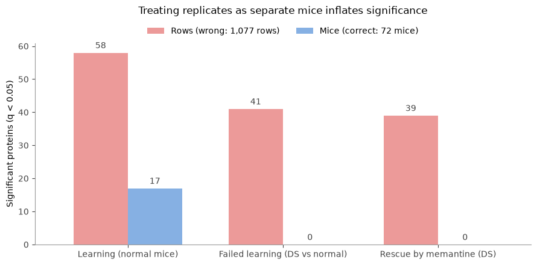
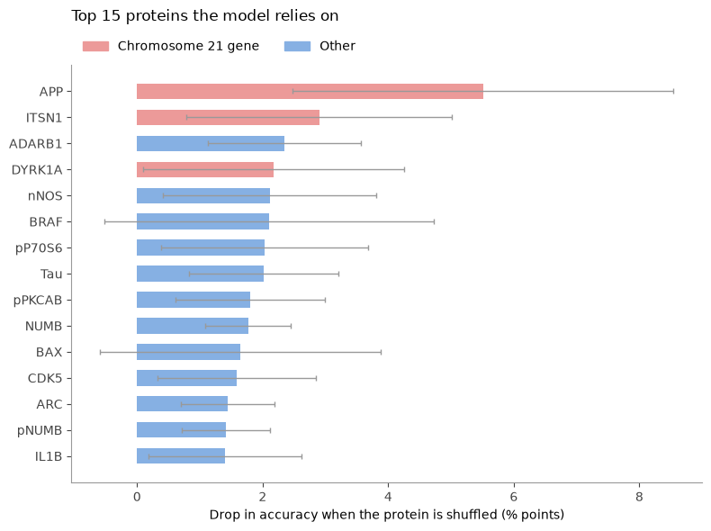

# Mice Protein Expression: Learning in a Down Syndrome Mouse Model

Which brain proteins change when mice learn, when learning fails in a Down syndrome model, and when the drug **memantine** rescues it?

This project re-analyses the [Mice Protein Expression dataset](https://archive.ics.uci.edu/dataset/342/mice+protein+expression) (Higuera, Gardiner & Cios, 2015) with **mouse-level statistics** and **machine learning validated on unseen mice**.

## Key idea

The dataset has 1,080 rows, but they come from only **72 mice**: each mouse's brain sample was measured **15 times** (technical replicates). The replicates of one mouse are very similar, so rows are **not independent**.

- **Statistics** are done on **one value per mouse** (the average of its replicates).
- **Models** are validated with a **split by mouse**, so a mouse is never in both the training and the test set.

Treating the 1,077 rows as separate mice would report **41** significant proteins for failed learning; the correct mouse-level test finds **0**.



## Main findings

- **Data quality:** `ARC_N` and `pS6_N` are **identical columns** (a data error), so pS6_N was removed. Missing values affect **whole mice**, not random rows (e.g. BCL2 was never measured in 19 mice).
- **Biology check:** chromosome 21 proteins are higher in Down syndrome mice (APP +17%).
- **Learning has the strongest effect:** 17 proteins change significantly in normal mice that learn; **SOD1** alone separates learning from no-learning.
- **Failed learning and rescue:** candidate proteins (NR2A, P38, Tau, NUMB), but **none significant** after FDR correction with only 7–9 mice per group. P38 and Tau show a possible rescue pattern with memantine.
- **Machine learning (split by mouse):** SVM predicts the 8 classes with **69% accuracy per row, 76% per mouse** (guessing: 14%). Learning vs no learning ~100%, Down syndrome vs normal 85%, memantine vs saline 79%.
- **Key proteins for the model:** APP, ITSN1 and DYRK1A (chromosome 21), plus Tau and NUMB.



See [REPORT.md](REPORT.md) for the full write-up.

## Project structure

```
├── README.md
├── REPORT.md                        # Full report
├── Mice_Protein_Expression.ipynb    # All analysis, step by step
├── requirements.txt
├── data/
│   └── Data_Cortex_Nuclear.xls      # Original dataset (UCI, CC BY 4.0)
└── figures/                         # Charts from the notebook
```

## Notebook steps

1. **First look:** 72 mice × 15 replicates, 77 proteins, highly correlated proteins
2. **Cleaning:** duplicate column, missing values per mouse, filling small gaps
3. **Exploration:** mice per class, outliers, chromosome 21 check, SOD1 and learning, replicates
4. **Statistics:** Mann–Whitney tests on mouse averages with FDR correction; Kruskal–Wallis across 8 classes
5. **Machine learning:** Logistic Regression, Random Forest and SVM with `StratifiedGroupKFold` (split by mouse)
6. **Feature importance:** permutation importance on unseen mice
7. **Conclusions**

## How to run

```bash
git clone https://github.com/<your-username>/<repo-name>.git
cd <repo-name>
pip install -r requirements.txt
jupyter notebook Mice_Protein_Expression.ipynb
```

Then **Restart & Run All**. The notebook reads `data/Data_Cortex_Nuclear.xls`.

## Data and citation

Dataset: Higuera C, Gardiner K, Cios K. *Mice Protein Expression* [Dataset]. UCI Machine Learning Repository, 2015. https://doi.org/10.24432/C50S3Z — licensed under [CC BY 4.0](https://creativecommons.org/licenses/by/4.0/).

Paper: Higuera C, Gardiner KJ, Cios KJ (2015). Self-Organizing Feature Maps Identify Proteins Critical to Learning in a Mouse Model of Down Syndrome. *PLoS ONE* 10(6): e0129126.
