# Proteins Linked to Learning in a Down Syndrome Mouse Model

*A re-analysis of the Mice Protein Expression dataset with mouse-level statistics and machine learning*

## 1. Introduction

Down syndrome is caused by an extra copy of chromosome 21 and leads to learning difficulties. The Ts65Dn mouse carries an extra copy of many of the matching genes and is a standard model of Down syndrome. These mice fail a learning task (context fear conditioning), but the drug **memantine**, which blocks NMDA receptors, can rescue their learning.

Higuera et al. (2015) measured 77 proteins in the cortex of these mice. This project asks three questions:

1. Which proteins change when **normal mice learn**?
2. Which proteins differ when **learning fails** in Down syndrome mice?
3. Which proteins does **memantine** change when it rescues learning?

The main improvement over a standard analysis is that every test and model works **at the level of the mouse**, not the row.

## 2. Data

- **72 mice** (38 control, 34 Ts65Dn), **77 proteins** measured in the nuclear fraction of the cortex.
- **8 classes** from three factors: genotype (control `c` / Ts65Dn `t`), behaviour (learning `CS` / no-learning `SC`) and treatment (memantine `m` / saline `s`). 7–10 mice per class.

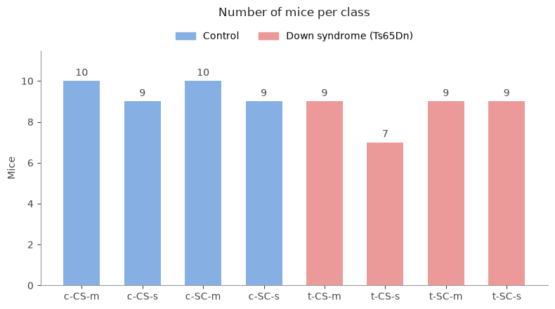

- **15 technical replicates per mouse:** one brain sample was measured 15 times (3 replicates × 5 dilutions), giving 1,080 rows. The replicates of one mouse are similar but not identical, partly because of the measurement method.

The dataset description states that each measurement "can be considered as an independent sample". This project shows that this assumption strongly inflates results.

## 3. First look and data cleaning

- **Different scales:** protein means range from ~0.12 to ~3.8, so proteins must be scaled before modelling.
- **Correlated proteins:** 14 pairs have |r| > 0.9 (mouse averages), mostly proteins of the same pathway (BRAF → MEK → ERK → ELK), a protein and its active form (NR1 / pNR1), or histone marks (AcetylH3K9 / H3AcK18).

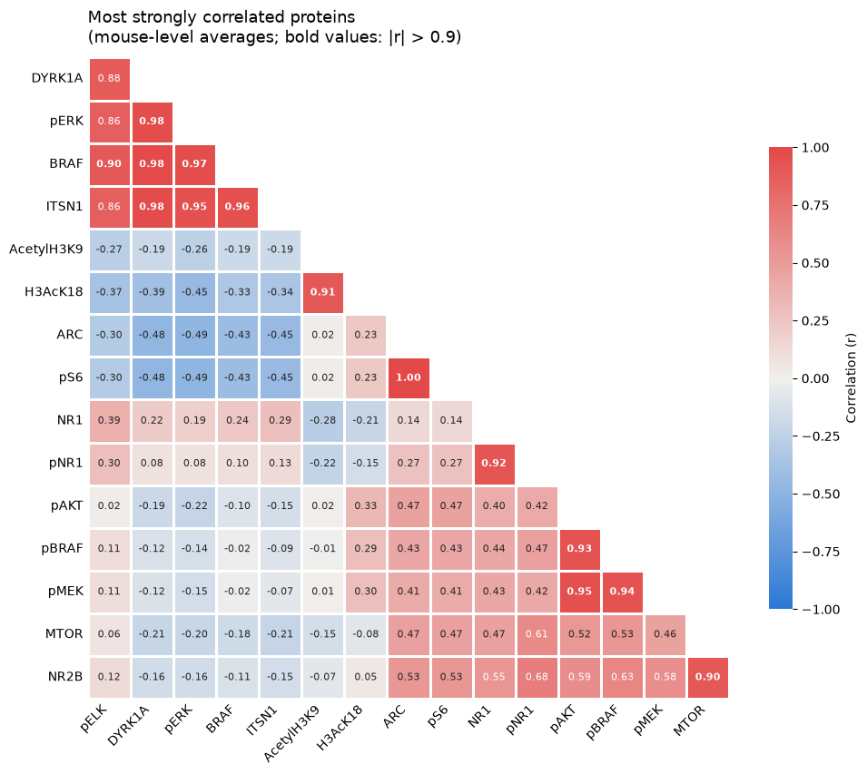

- **Duplicate column:** `ARC_N` and `pS6_N` have a correlation of 1.00, and `.equals()` confirms their values are identical. They are different proteins, so this is a data error; `pS6_N` was removed (76 proteins left).
- **Missing values come in whole mice:** when a protein is missing, it is usually missing for all 15 replicates of a mouse (84 mouse × protein cases; e.g. BCL2 was never measured in 19 mice). Gaps appear in all 8 classes.

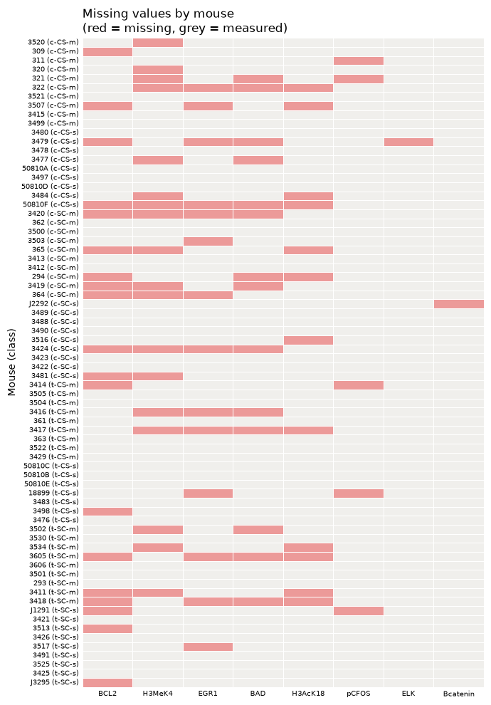

- **Almost-empty rows:** 3 replicates of mouse 3426 were missing 43 proteins each and were removed (the mouse keeps 12 replicates; all 72 mice kept).
- **Small gaps** (a mouse missing only some replicates of a protein) were filled with **that mouse's own average** for that protein, never with the class average, which would leak the label.
- **Remaining gaps** (proteins never measured for a mouse) were filled **inside the model pipeline** (`KNNImputer`), learning only from the training mice.

## 4. Exploratory analysis

- **Skewed proteins and outliers:** 17 proteins are strongly skewed. For BRAF and DYRK1A, the long tail is one whole mouse (3484); for others, single replicates. Comparing each mouse with its own class, mouse **3484** (c-CS-s) has 5 MAPK-related proteins ~4.5× its class (DYRK1A, BRAF, pERK, ITSN1, pELK), and mice **293** and **3516** have very high AcetylH3K9. All mice were kept; models use robust scaling.
- **Biology check:** proteins of chromosome 21 genes are higher in Ts65Dn mice (APP +17%, ITSN1 +15%, DYRK1A +11%, SOD1 +5%), as expected from the extra gene copy.

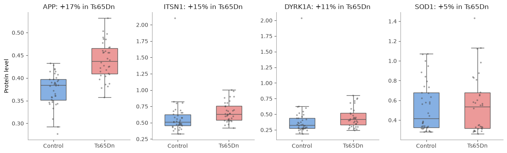

- **SOD1 separates learning:** SOD1 is ~2.3× higher in no-learning (S/C) mice, with no overlap between the groups.

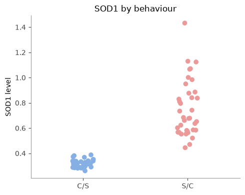

- **Replicates stay together:** the replicates of one mouse lie close together, so a model could recognise the mouse instead of learning its class. All modelling therefore splits by mouse.

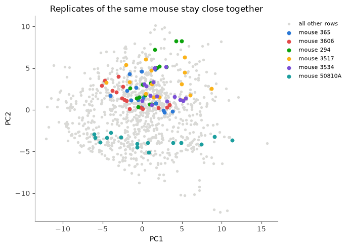

## 5. Statistical tests

**Method:** Mann–Whitney U test on **mouse averages** (one value per mouse), with Benjamini–Hochberg FDR correction for 76 proteins (significant: q < 0.05). log2 fold change is based on medians.

| Comparison | Mice | p < 0.05 | q < 0.05 |
|---|---|---|---|
| Learning, normal mice (c-SC-s vs c-CS-s) | 9 vs 9 | 27 | **17** |
| Failed learning (c-CS-s vs t-CS-s) | 9 vs 7 | 13 | **0** |
| Rescue by memantine (t-CS-s vs t-CS-m) | 7 vs 9 | 5 | **0** |

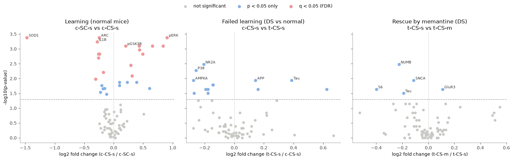

- **Learning** changes many proteins; the strongest are SOD1, pERK, ARC (a known memory gene) and IL1B.
- **Failed learning** (NR2A, P38, AMPKA, APP, Tau) and **rescue** (NUMB, SNCA) show candidate proteins, but none survive FDR correction with only 7–9 mice per group.
- **Pseudoreplication:** treating the 1,077 rows as independent mice would report 58, 41 and 39 significant proteins instead of 17, 0 and 0.

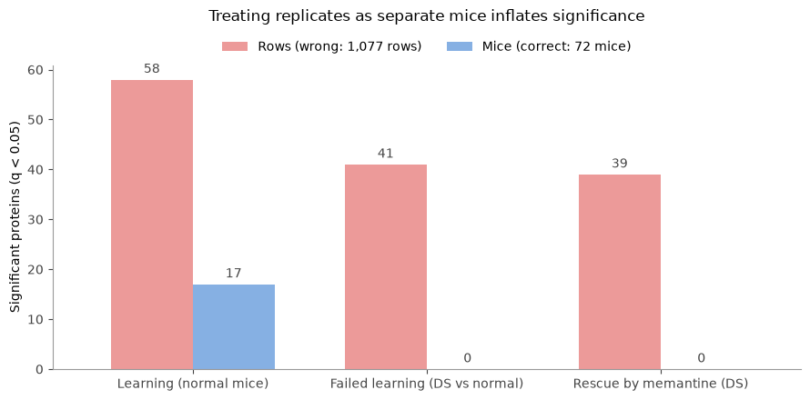

- **Possible rescue:** P38 and Tau move away from normal in failed learning and back towards normal with memantine. APP stays high, as memantine cannot remove the extra gene copy.

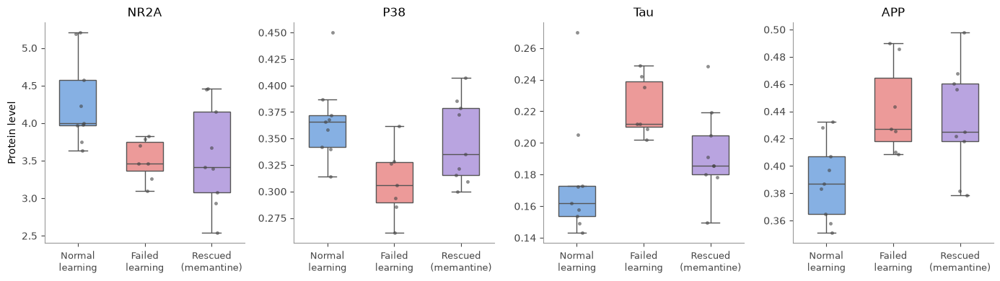

- **All 8 classes (Kruskal–Wallis):** 46 of 76 proteins differ; the top ones (SOD1, pERK, DYRK1A, CaNA, ITSN1) match the learning comparison.

## 6. Machine learning

**Method:** predict the class (8 groups) from the 76 proteins. Pipeline: `KNNImputer` (fills never-measured proteins from similar mice) → `RobustScaler` (median 0, IQR 1; robust to outliers) → model. Validation with `StratifiedGroupKFold` (5 folds): in every fold, 57–58 mice are used for training and 14–15 different mice for testing, with **no mouse shared**.

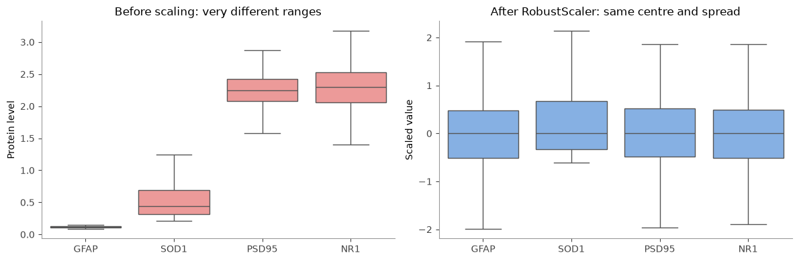

| Model | Accuracy (split by mouse) |
|---|---|
| Baseline (most common class) | 14% |
| Logistic Regression | 66% |
| Random Forest | 59% |
| **SVM** | **69%** |

- Letting each mouse's ~15 rows vote raises the SVM accuracy to **76% per mouse** (55 of 72).
- **Failed learning (t-CS-s)** is the hardest class: 3 of 7 mice are predicted as rescued (t-CS-m). c-CS-s and c-CS-m are also mixed up, as memantine changes little in normal mice.

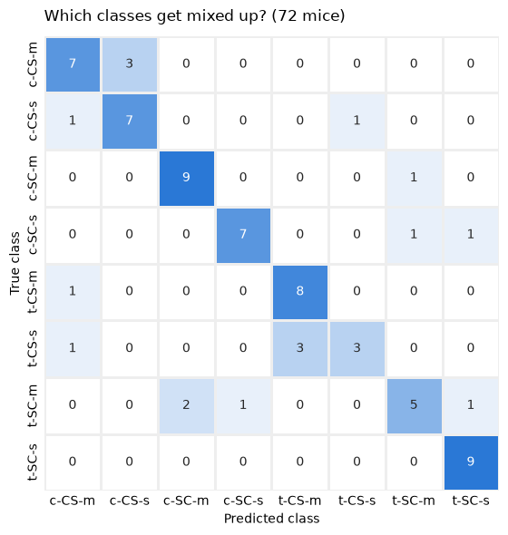

- **Yes/no tasks:** learning vs no learning **~100%**, Down syndrome vs normal **85%**, memantine vs saline **79%**.

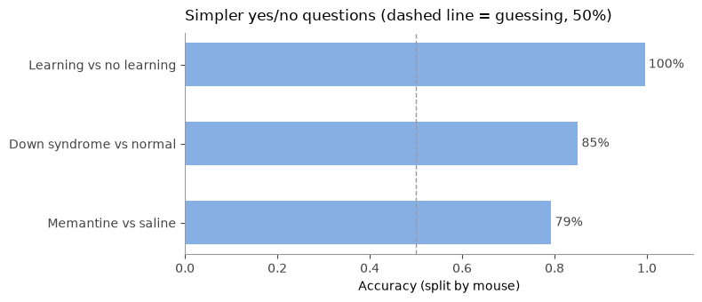

## 7. Which proteins matter?

**Method:** permutation importance on the test mice of each fold: shuffle one protein and measure the drop in accuracy.

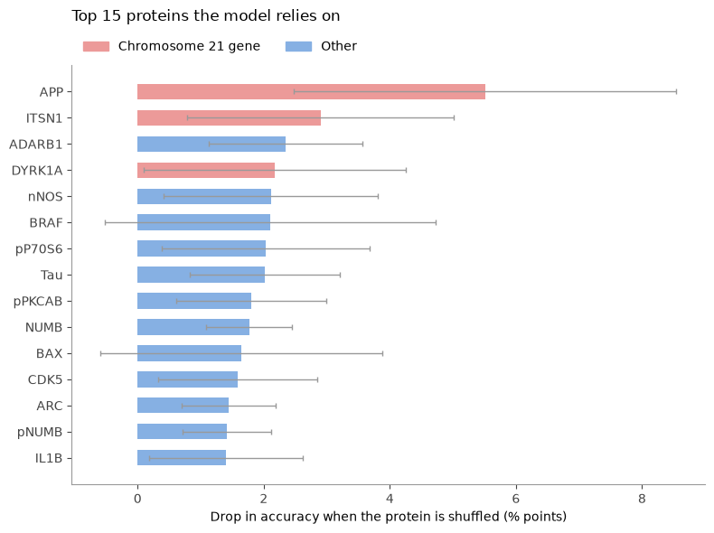

- The model relies most on **APP** (~5.5 points), **ITSN1** and **DYRK1A**, all chromosome 21 genes, and on **Tau** and **NUMB** (both rescue candidates in Section 5).
- Model and statistics rankings agree only moderately (r = 0.38). SOD1 ranks #1 in the statistics but #64 for the model: its learning information is shared with many correlated proteins, so shuffling it alone barely matters.

## 8. Limitations

- **Small sample:** 7–10 mice per class limits statistical power; small effects cannot be confirmed.
- **Technical replicates:** averaging them loses within-mouse variation; mixed models could use all rows correctly.
- **Correlated proteins** make single-protein importance hard to interpret.
- **Outliers** (mice 3484, 293, 3516) were kept; their cause (biology or measurement) is unknown.
- No independent test dataset was available.

## 9. Conclusions

1. The 15 replicates per mouse are **not independent**. Ignoring this inflates the number of significant proteins for failed learning from 0 to 41.
2. **Learning** produces the strongest protein changes (17 proteins, led by SOD1, pERK and ARC).
3. **Chromosome 21 proteins** (APP, ITSN1, DYRK1A) are higher in Down syndrome mice and are the model's most important features.
4. With a split by mouse, the best model reaches **69% (76% per mouse)** for 8 classes. Failed and rescued learning are the hardest to separate; **P38, Tau and NUMB** are candidates for the memantine rescue but need confirmation in larger studies.
5. The dataset contains a **duplicated column** (ARC_N = pS6_N) that should be removed in any analysis.

## References

- Higuera C, Gardiner KJ, Cios KJ (2015). Self-Organizing Feature Maps Identify Proteins Critical to Learning in a Mouse Model of Down Syndrome. *PLoS ONE* 10(6): e0129126. https://doi.org/10.1371/journal.pone.0129126
- Higuera C, Gardiner K, Cios K (2015). *Mice Protein Expression* [Dataset]. UCI Machine Learning Repository. https://doi.org/10.24432/C50S3Z
